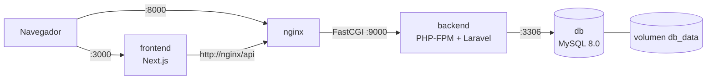

# 📝 Notas – Ecosistema Docker (Next.js + Laravel + MySQL)

## Descripción general
App de notas (crear, listar, borrar) usada para demostrar la contenerización de un
entorno de producción con **builds multi-stage**, imágenes ligeras y orquestación con
**docker-compose**.

- **Frontend:** Next.js 16 (App Router)
- **Backend:** API REST en Laravel 12 (PHP 8.4-FPM + Nginx)
- **Base de datos:** MySQL 8.0

## Arquitectura de contenedores



| Servicio | Imagen base | Puerto | Expuesto al host |
|----------|-------------|--------|------------------|
| frontend | node:20-alpine | 3000 | Sí |
| nginx | nginx:1.27-alpine | 80 | Sí (8000) |
| backend | php:8.4-fpm-alpine | 9000 | No |
| db | mysql:8.0 | 3306 | No |

## Cómo ejecutarlo

1. Clona el repositorio y entra a la carpeta.
2. Copia las variables de entorno:
   ```powershell
   Copy-Item .env.example .env
   ```
3. Genera la APP_KEY de Laravel y pégala en `.env`:
   ```powershell
   "base64:" + [Convert]::ToBase64String((1..32 | ForEach-Object { [byte](Get-Random -Maximum 256) }))
   ```
4. Levanta todo con un solo comando:
   ```powershell
   docker compose up -d --build
   ```
5. Abre http://localhost:3000 (frontend) o http://localhost:8000/api/notas (API).

Detener: `docker compose down` (añade `-v` para borrar también los datos).

Para conectar MySQL Workbench (puerto 3307):
`docker compose -f docker-compose.yml -f docker-compose.dev.yml up -d`

## Variables de entorno (.env.example)
| Variable | Descripción |
|----------|-------------|
| MYSQL_ROOT_PASSWORD | Contraseña del usuario root de MySQL |
| MYSQL_DATABASE | Nombre de la base de datos |
| MYSQL_USER / MYSQL_PASSWORD | Usuario y contraseña que usa Laravel |
| APP_KEY | Clave de cifrado de Laravel |

## Decisiones técnicas

### Frontend (Next.js)
- **3 etapas** (`deps` → `builder` → `runner`): las dependencias y el build no llegan a la imagen final.
- `npm ci` se ejecuta tras copiar solo `package*.json`: si el código cambia pero las dependencias no, Docker reutiliza la caché.
- `output: "standalone"`: Next genera un servidor mínimo (`server.js`) con solo los archivos necesarios para producción.
- Corre con un usuario sin privilegios (`nextjs`) y `node:20-alpine`.
- La URL de la API se pasa en tiempo de ejecución (`API_URL`), así la misma imagen sirve en cualquier entorno.

### Backend (Laravel)
- **2 etapas:** en la primera, `composer:2` instala las dependencias; la imagen final (`php:8.4-fpm-alpine`) solo recibe la carpeta `vendor/`, sin Composer.
- Se usa `php:8.4-fpm-alpine` porque las dependencias actuales de Laravel requieren PHP >= 8.4.1 (la tarea pide PHP 8.2 o superior).
- `composer.json` y `composer.lock` se copian primero para cachear la instalación de dependencias.
- `--no-dev` y `--optimize` para un autoload ligero y sin paquetes de desarrollo.
- Extensiones: solo se instala `pdo_mysql`; `mbstring`, `openssl`, `tokenizer`, `xml`, `ctype` y `json` ya vienen en la imagen oficial (se verifica con `php -m` durante el build).
- `.dockerignore` evita copiar `.env`, `vendor` local y logs.
- `bootstrap/cache/*.php` se excluye con `.dockerignore` para que Laravel regenere el caché de paquetes dentro de la imagen, sin dependencias de desarrollo.
- Nginx va en un contenedor aparte como proxy inverso hacia PHP-FPM.
- Las migraciones se ejecutan al arrancar, cuando MySQL ya está saludable.

### Base de datos (MySQL)
- Imagen oficial `mysql:8.0` configurada con variables de entorno.
- Volumen persistente `db_data` en `/var/lib/mysql`.
- Script opcional `db/init.sql` montado en `/docker-entrypoint-initdb.d/`.
- **No se expone** el puerto 3306 al host; solo es accesible dentro de la red de Docker.
- `healthcheck` + `depends_on: service_healthy` para que el backend espere a la BD.

## Tamaño de imágenes
| Imagen | Tamaño |
|--------|--------|
| frontend | 289 MB |
| backend | 186 MB |
| nginx | 73.6 MB |